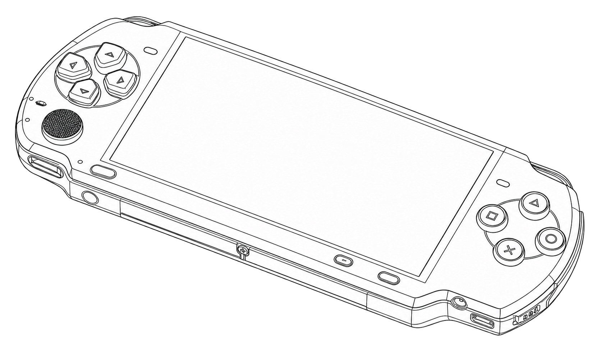
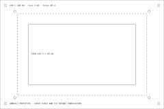

# CyberDeck



*Generated line-art concept illustration.*

A local system dashboard, power-planning tool, setup generator, and enclosure study for a Raspberry Pi 4 with the official **7-inch Touch Display 2**. Runtime code uses only the Python standard library. The browser needs no internet service, account, map tiles, CDN, or global package.

**Hardware is unbuilt.** Software, generated templates, and analytic geometry checks are available. Actual Pi boot, kiosk startup, CAD rendering, printing, fit, retention, electrical load, runtime, and thermal tests remain pending.

## Run

Use Python **3.11 or later** from the repository directory:

```sh
python3 -m cyberdeck serve
```

Open **http://127.0.0.1:8794/**. The default mode is explicitly labeled **synthetic replay**. Pause updates, request one sample, inspect data sources, and calculate a declared power budget. History contains only received samples, with gaps for missing values. Its horizontal axis is sample order, not elapsed wall time. The synthetic trace repeats every 60 seconds.

To read a supported Linux target instead:

```sh
python3 -m cyberdeck status --live
python3 -m cyberdeck serve --live
```

Live mode reads fixed local `/proc` and `/sys` paths and disk usage. Missing sensors stay **Not reported**; replay values are never substituted. One-minute load is not CPU utilisation. BAT0 is the only supported battery sensor path; a typical Pi with an external power bank will not report a battery percentage. The calculator does not infer remaining charge. Other operating systems can still run replay and may report only disk data in live mode.

## CLI and target setup

```sh
python3 -m cyberdeck budget --config examples/power.json
python3 -m cyberdeck enclosure --out runs
python3 -m cyberdeck prepare --out target-setup --user deck
```

Output directories must be new and their parent must exist. The enclosure command writes SVG, OpenSCAD source, and JSON dimensions. The setup command writes a systemd user service, a labwc autostart fragment, and manual deployment steps. It **does not install, enable, flash, reboot, invoke a shell, or change this computer's configuration**. Review the generated [setup example](docs/setup/DEPLOYMENT.md), set the correct target username/path, and follow the official OS/display guides on your hardware.

## Actual calculated outputs

The [recorded budget](docs/results/budget.json) uses declared sample inputs, not a tested battery: 74 Wh, 85% conversion efficiency, 20% energy reserve, and 13 W constant load. It produces **62.90 Wh** after conversion, **50.32 usable Wh**, **4.84 full model hours**, and **3.87 usable model hours**. Comparing 13 W with a declared 15.3 W rating leaves 2.3 W nominal headroom; this does not measure electrical compatibility or peak demand.



The default enclosure is **240 × 160 × 70 mm**, with a **156.5 × 89 mm** viewing window, 3 mm wall/face, and eight Ø3.4 mm clearances. See [OpenSCAD source](web/assets/enclosure.scad), [geometry metadata](web/assets/enclosure.json), [proposed BOM](hardware/BOM.csv), and [assembly/evidence plan](hardware/ASSEMBLY.md). Dimensions and separation are checked analytically. The annotated SVG is a drawing, not machine-ready toolpaths. No STL or fabrication-ready fit is claimed.

```sh
python3 scripts/reproduce.py
```

This runs the actual CLI in temporary directories and reproduces **11 committed artifacts byte-for-byte**, including enclosure files, setup templates, budget/replay reports, the public BOM copy, and a source/artifact hash manifest. Replay is labeled synthetic and records no collection timestamp. `--write` intentionally refreshes outputs after reviewed source changes.

## Development checks

Runtime has no third-party dependency. Development uses the small JSON Schema validator in `requirements-dev.txt`; create a virtual environment before installing it.

```sh
python3 -m venv .venv
.venv/bin/python -m pip install -r requirements-dev.txt
.venv/bin/python -m unittest discover -s tests -v
node --test tests/view-model.test.mjs
python3 scripts/reproduce.py
```

Use the equivalent virtual-environment Python path on Windows. Node 22+ is needed only for UI-model development tests. Tests cover units, null sensor handling, byte/depth limits, invalid models, reserve denominators, geometry bounds, output ownership, setup safety, loopback/asset restrictions, and actual HTTP responses against the [OpenAPI contract](docs/api/openapi.json). CI runs Python 3.11/3.14 on Linux, macOS, and Windows; inspect the result for the current commit. Browser handlers require separate UI review.

Read [methods and official sources](docs/methods.md), [the contract](docs/contract.md), [contributing](CONTRIBUTING.md), and [security](SECURITY.md).

## History and attribution

Implemented in October 2026 in the renamed `familyphoto` repository. The original Android app remains at `archive/before-cyberdeck-2026-10-27`, revision `8df4fba1d547303f4d25d04630d2c1bafd860e23`. No original application code/assets are reused. MIT applies to the new implementation; it does not relicense the old unlicensed source. Existing repository age and stars do not represent this project's implementation date.

The approved generated cover has [portable provenance](docs/images/cover-provenance.json). It is an independent concept and does not depict the generated enclosure. The panel drawing is actual program output. Neither is proof of a physical build. MyPortfolio is unchanged.
